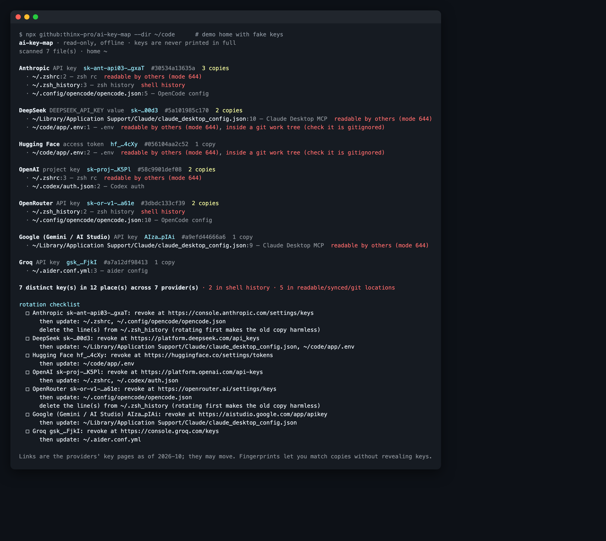

# ai-key-map

**Need to rotate your AI keys? First find every copy.** A read-only, offline map of where your OpenAI / Anthropic / OpenRouter / Gemini / Groq / DeepSeek / … keys live on this machine. It groups copies of the same key and turns them into a rotation checklist.

   



## Why

In October 2026, OpenCode told part of its Console users to revoke and replace the OpenAI / Anthropic keys they had stored there (discussed on Hacker News and r/LocalLLaMA). Any BYOK gateway, relay or agent platform carries the same risk. Revoking a key on the provider dashboard is the easy part. The tedious, error-prone part comes next: the same key is usually also in `~/.zshrc`, an agent's auth file, an MCP server config, a project `.env`, and your shell history. Miss one copy and something quietly breaks, or a copy you forgot about keeps working somewhere.

`ai-key-map` answers "where are all the copies?" in about one second, without ever printing a key.

## Quick start

```bash
npx github:thinx-pro/ai-key-map                     # home directory + current environment
npx github:thinx-pro/ai-key-map --dir ~/code         # also scan project trees for .env / config files
npx github:thinx-pro/ai-key-map --md keys-report.md  # write a checklist you can tick off
```

## What it does

- **Finds keys by format**: Anthropic (`sk-ant-api…`, admin keys, Claude subscription OAuth tokens), OpenAI (project, service-account, admin, legacy), OpenRouter, Google AI Studio / Gemini, Groq, xAI, Perplexity, Hugging Face, Replicate, Fireworks, Cerebras.
- **Finds prefix-less keys by variable name**: DeepSeek, Mistral, Together, Cohere, Moonshot / Kimi, DashScope / Qwen, Zhipu / Z.ai, Voyage, e.g. `DEEPSEEK_API_KEY=…` in a `.env` or an MCP server's `env` block. Placeholders (`your-key-here`, `${VAR}`, `op://…`, empty values) are ignored.
- **Looks where AI keys actually end up**: shell rc files and **shell / REPL history**, `~/.env`, Claude Code, Codex, OpenCode, aider, Continue, Cursor MCP, Gemini CLI, Goose, Crush, aichat, fabric, Zed / VS Code settings, Claude Desktop MCP config, the `llm` CLI's key store, the current process environment, and any project tree you pass with `--dir` (skipping `node_modules`, `.git`, build folders).
- **Groups copies of the same key** with a 12-character SHA-256 fingerprint, so you can see that "the Anthropic key in `.zshrc` is the same one as in `opencode.json`" without the key ever being shown.
- **Flags risky places**: shell history, group/world-readable files, files inside a git work tree (check they are ignored), cloud-synced folders (iCloud / Dropbox / OneDrive / Google Drive), and environment variables that every agent started from your shell inherits.
- **Prints a rotation checklist** for each key: the provider's key page, then each place to update, and which history lines to delete.

Output formats: a coloured terminal view, `--json` (masked keys and fingerprints only), and `--md FILE`. `--fail-on-find` exits 1, so you can use it as a pre-commit or CI check on a project tree.

## Safety

- **Read-only.** It never edits, moves or deletes anything, and has no "fix" mode on purpose.
- **Offline.** It makes no network requests at all: no key validation calls, no telemetry. Check `src/` and `bin/` (about 450 lines, zero dependencies).
- **Never prints a key.** Output shows only the known prefix plus the last 4 characters (`sk-proj-…K5Pl`), the same as provider dashboards. A test asserts that no output format contains a full key, or a key minus its last 4 characters.
- The repository contains no key-shaped strings: the test fixtures generate fake keys at runtime.

## Real-world check

On a real development Mac (home directory plus one workspace tree, 78 candidate files, about 40 ms) the first run found 2 real keys in 4 places, including one key copied into `.env`, `.env.local` and a forgotten `.env.local.bak`. The same run surfaced a bug: an empty `OPENAI_API_KEY=` in `.env.example` files made the next line count as the value. That was fixed before release, and a regression test was added.

## Limitations and roadmap

- It only knows the formats and locations listed above. Keys stored in the macOS Keychain, 1Password and similar tools are out of scope; they are the right place for keys anyway.
- Variable-name matching only covers known names. A DeepSeek key in a variable called `MY_LLM_KEY` will be missed.
- "Group/world-readable" is about the file's own mode. On macOS your home directory is usually `700`, which already blocks other users.
- Planned: Windows paths (`%APPDATA%`), JetBrains AI and Cline / Roo settings, `--since` to show files changed after a breach date, and a check for whether a `.env` is actually tracked by git.

## License

MIT

---

### 中文简介

**ai-key-map**：要换 AI Key，得先找到所有副本。它只读、离线地列出本机上 OpenAI / Anthropic / OpenRouter / Gemini / Groq / DeepSeek 等 Key 出现在哪里：shell 配置与**命令历史**、Claude Code / Codex / OpenCode / aider / Cursor / Gemini CLI / Claude Desktop MCP 配置、项目 `.env`、当前环境变量。同一个 Key 的多个副本按指纹归组，同时标出风险位置（历史记录、可读权限、git 工作区、云同步目录），并按 Key 生成轮换清单。从不打印完整 Key，不联网，零依赖：`npx github:thinx-pro/ai-key-map`。
